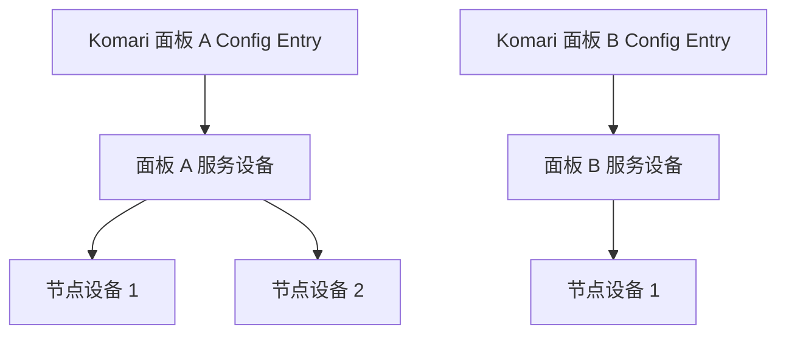

# Komari for Home Assistant


[](https://www.home-assistant.io/)
[](https://komari-monitor.github.io/komari-document/)
[](https://github.com/lucklyduck/Komari/actions/workflows/validate.yml)


这是一个第三方自定义集成，用于将一个或多个
[Komari](https://github.com/komari-monitor/komari) 服务器监控面板接入
[Home Assistant](https://www.home-assistant.io/)。

每次添加集成都会接入一个独立的 Komari 面板。集成会为面板创建服务设备，并将其中
的每个节点注册为独立子设备。服务器状态、资源使用、到期时间、流量限额和 Ping
统计均可用于仪表盘、历史记录与自动化。

> [!WARNING]
> 当前候选发布为 [`0.3.0-rc.1`](https://github.com/lucklyduck/Komari/releases/tag/v0.3.0-rc.1)，
> 适合兼容性测试；上一版为 `0.2.0-alpha.1`。它可以作为 HACS 自定义仓库安装，但尚未
> 收录到 HACS 默认仓库，也不是 Home Assistant 或 Komari 官方集成。升级前请备份 Home
> Assistant 配置。

## 目录

- [主要功能](#主要功能)
- [设备与实体](#设备与实体)
- [环境要求](#环境要求)
- [安装](#安装)
- [配置](#配置)
- [选项](#选项)
- [升级与卸载](#升级与卸载)
- [注意事项](#注意事项)
- [故障排查](#故障排查)
- [常见问题](#常见问题)
- [开发与测试](#开发与测试)
- [当前限制与路线图](#当前限制与路线图)
- [开发与验收指南](DEVELOPMENT.md)

## 主要功能

- 通过 Komari `/api/rpc2` 接口进行全异步、只读的 JSON-RPC 2.0 通信。
- 公开面板可匿名访问，私有面板可使用 API Key 认证。
- 可同时添加多个面板；各面板的配置、轮询周期和故障状态互相独立。
- 自动发现面板节点，并在 Home Assistant 中建立面板与节点的父子设备关系。
- 节点实体涵盖在线状态、资源使用率、负载、温度、网络流量及连接数量。
- 根据 Komari 返回的数据按需创建 GPU、温度、到期、续费和流量限额实体。
- 自动发现 Komari Ping 任务，由用户选择要同步的任务和统计项。
- 发现可保留的动态 Metric Definitions；用户可选择非内置指标、设置精确 tag 过滤并
  在保存前查看有界实体预览。
- 可重载配置、重新认证 API Key、重新配置 URL/TLS，并迁移旧配置。
- 对象连续三次从权威清单中消失后，清理对应的陈旧节点或 Ping 实体。
- Diagnostics 会脱敏；错误日志控制重复输出，Repairs 可在问题消失后自动清除。
- 配置流程和实体名称提供简体中文与英文翻译。

## 设备与实体



不同面板即使报告相同节点 UUID，也会创建彼此隔离的设备和实体，不会错误合并。

### 面板设备

| 实体 | 类型 | 用途 |
| --- | --- | --- |
| RPC 连接 | Connectivity binary sensor | HA 是否能够连接面板 RPC2 |
| 任一节点故障 | Problem binary sensor | 是否存在明确离线的可见节点 |
| 节点总数 | Sensor | 当前可见节点数量 |
| 在线节点数 | Sensor | 当前明确在线的节点数量 |
| 离线节点数 | Sensor | 当前明确离线的节点数量 |
| Komari 版本 | Diagnostic sensor | 面板软件版本 |
| RPC 版本、构建哈希 | Diagnostic sensor | 协议及构建诊断信息 |

### 节点设备

| 分类 | 实体 |
| --- | --- |
| 连接状态 | 在线状态、最后采集时间 |
| 处理器 | CPU 使用率、GPU 使用率（存在有效 GPU 时） |
| 内存与存储 | 内存使用率/已用/总量、Swap 使用率/已用、磁盘使用率/已用/总量 |
| 系统负载 | 1、5、15 分钟负载，温度（存在有效温度时） |
| 网络 | 上下行速率、Agent 启动后累计上传/下载流量 |
| 连接与进程 | 进程数、TCP 连接数、UDP 连接数 |
| 到期与续费 | 到期时间、剩余时间、是否到期、自动续费、计费周期 |
| 流量限额 | 限额、限额口径、按口径计算的已用流量、使用率 |
| Ping | 最新延迟、丢包率及可选的 min/max/avg/P50/P99/stddev |
| 动态指标 | 用户选择的非内置、节点归属 Metric series（默认关闭） |

部分诊断实体默认禁用。GPU、温度、到期和流量实体只在服务端提供有效数据时创建。
缺少这些实体通常表示没有对应数据，不代表集成加载失败。

## 环境要求

| 项目 | 要求 |
| --- | --- |
| Home Assistant | `2026.8.2` 或更高版本；这是当前开发与测试基线 |
| Komari | `1.0.7` 或更高版本；这是 RPC2 官方最低版本，实际部署请使用当前稳定版 |
| 网络 | Home Assistant 必须能够访问面板根地址及其 `/api/rpc2` 路径 |
| 认证 | 公开面板可匿名；私有面板需要有效 API Key |
| 安装权限 | 能够向 Home Assistant 配置目录写入 `custom_components` |
| Python | 普通用户无需单独安装；开发环境使用 Python `3.14.x` |

集成不会只按 Komari 版本号启用功能，而会调用 `rpc.methods` 探测面板的实际能力。
旧版本即使缺少可选 Ping 方法，也仍可使用核心节点监控。

当前验证以 Home Assistant Core 开发环境为主。Home Assistant OS、Supervised 和
Container 可按相同目录结构安装自定义集成；正式使用前先在测试实例中验证。

## 安装

### 手动安装

1. 从 GitHub Releases 下载目标版本的源码压缩包并解压。
2. 将仓库中的 `custom_components/komari` 整个目录复制到 Home Assistant 配置目录：

   ```text
   <config>/custom_components/komari
   ```

3. 确认最终路径中直接包含 `manifest.json`，不要多嵌套一层仓库目录：

   ```text
   <config>/custom_components/komari/manifest.json
   ```

4. 重启 Home Assistant。
5. 打开“设置 → 设备与服务 → 添加集成”，搜索 Komari。

不同安装方式的 `<config>` 位置可能不同。Home Assistant OS 通常为 `/config`；
Container 用户应使用映射到容器 `/config` 的宿主机目录。

### HACS

正式发布版本可通过 HACS 安装和管理：

[](https://my.home-assistant.io/redirect/hacs_repository/?owner=lucklyduck&repository=Komari&category=integration)

1. 确认 Home Assistant 中已经安装并配置 HACS。
2. 点击上面的按钮；也可以进入 HACS，打开右上角菜单中的“自定义存储库”。
3. 填写 `https://github.com/lucklyduck/Komari`，类别选择“集成”。
4. 打开 Komari 仓库并下载需要的 GitHub Release 版本。
5. 重启 Home Assistant，然后在“设置 → 设备与服务 → 添加集成”中搜索 Komari。

当前仓库尚未收录到 HACS 默认仓库，因此初次安装需要先添加一次自定义存储库。
HACS 只负责下载和更新集成代码；面板 URL、API Key 和选项仍在 Home Assistant 的
Komari 配置流程中管理。

## 配置

添加集成时需要填写：

| 字段 | 必填 | 说明 |
| --- | --- | --- |
| 面板 URL | 是 | Komari 面板根地址，例如 `https://monitor.example.com` |
| API Key | 否 | 公开面板可留空；私有面板需要填写 |
| 验证 TLS 证书 | 是 | 默认开启，生产环境应始终保持开启 |

URL 末尾误填 `/api/rpc2` 时会自动规范化为面板根地址。URL 不应包含用户名、密码、
query 或 fragment。同一规范化 URL 只能添加一次。

要同时监控多个面板，请为每个面板分别“添加集成”。各面板使用独立的 Config Entry，
可以设置不同的 API Key、TLS、轮询周期和 Ping 任务。

私有面板最好为 Home Assistant 单独创建 API Key。不要复用账号密码，也不要把 Key
写入 YAML、自动化、截图或公开 Issue。

## 选项

在“设置 → 设备与服务 → Komari → 配置”中，可以为每个面板单独调整：

| 选项 | 默认值 | 可选范围或限制 |
| --- | ---: | --- |
| 核心状态轮询周期 | 30 秒 | 15～300 秒 |
| Ping 统计轮询周期 | 300 秒 | 60～1800 秒 |
| 到期/续费实体 | 开启 | 可关闭并清理对应实体 |
| 流量限额实体 | 开启 | 可关闭并清理对应实体 |
| Ping 任务 | 不选择 | 每个面板最多选择 8 个 |
| Ping 统计项 | `latest`、`loss` | 可增加 min/max/avg/P50/P99/stddev |

> [!NOTE]
> 请按实际需要设置轮询周期。持续高频请求会增加流量消耗。

### 数据刷新频率

集成首次加载时会立即获取各分支数据，之后按下表频率刷新：

| 数据项目 | 默认频率 | 是否可配置 | 说明 |
| --- | ---: | --- | --- |
| 节点在线状态、CPU、内存、磁盘、负载、网络和连接数 | 30 秒 | 是，15～300 秒 | 使用当前面板的“核心状态轮询周期” |
| 到期时间、自动续费、计费周期、流量限额和限额口径 | 10 分钟 | 否 | 这些项目来自节点清单；在 Komari 中修改后，HA 通常会在下一次节点清单刷新时取得新值 |
| 剩余时间和是否到期 | 30 秒 | 随核心状态周期 | 使用已取得的到期时间和当前 UTC 时间重新计算，因此到期状态最多延迟一个成功的核心轮询周期 |
| 按限额口径计算的已用流量和使用率 | 30 秒 | 随核心状态周期 | 使用最新 Agent 累计上传/下载计数计算；Agent 重启可能使计数归零 |
| 节点清单和新节点发现 | 10 分钟 | 否 | 清单暂时刷新失败时保留上一次成功结果，不立即删除节点 |
| Ping 任务列表 | 10 分钟 | 否 | 新任务先出现在选项中，不会自动启用 |
| 已选择的 Ping 统计 | 300 秒 | 是，60～1800 秒 | 使用当前面板的“Ping 统计轮询周期” |
| 面板版本和 RPC 能力 | 6 小时 | 否 | 用于低频能力探测和可选功能降级 |

每个 Config Entry 分别计算刷新周期，面板之间互不影响。核心状态刷新失败时，该面板
的运行时实体会暂时不可用。若只有节点清单或 Ping 分支失败，集成会保留旧结果，直到
满足相应的过期或清理条件；其他面板及仍能刷新的核心实体不受影响。

Ping 实体数量按“可见节点 × 已选任务 × 已选统计项”增长。每个面板最多创建 256 个
Ping 实体；配置时超过上限会阻止保存，运行中因节点增长超过上限会创建 Repair。

需要立即同步时，可重新加载集成。重新加载会立刻刷新全部数据分支。

### 重新认证与重新配置

- API Key 失效时，Home Assistant 会发起 Reauth；新 Key 成功后沿用原有设备和实体
  标识。
- “重新配置”可修改面板 URL 和 TLS 验证设置，但不会显示或修改 API Key。
- URL 实际变化时需要二次确认。如果要接入完全不同的面板，最好新增 Config Entry，
  以免沿用旧设备身份。

## 升级与卸载

### HACS 升级

1. 备份 Home Assistant 配置。
2. 在 HACS 或 Home Assistant 更新页面安装 Komari 的目标版本。
3. 重启 Home Assistant，使新版本代码生效。
4. 在集成页面确认版本、设备和实体正常；不要删除并重新添加 Config Entry，否则
   可能失去原有实体历史关联。

### 手动升级

1. 备份 Home Assistant 配置。
2. 下载目标版本，并用新的 `custom_components/komari` 覆盖旧目录内容。
3. 重启 Home Assistant。
4. 在集成页面确认版本、设备和实体正常；不要先删除 Config Entry，否则可能失去
   原有实体历史关联。

### 卸载

1. 在“设置 → 设备与服务”中删除所有 Komari Config Entry。
2. 若由 HACS 安装，从 HACS 中移除 Komari；手动安装则删除
   `<config>/custom_components/komari` 目录。
3. 重启 Home Assistant。

## 注意事项

### 流量并非权威账期用量

累计上传、累计下载和“按限额口径计算的已用流量”来自 Komari Agent 计数器。
Agent 重启、重装或计数器复位后，数值可能从较小值重新开始。集成会标记
`calculation_source=agent_counters` 和 `reset_sensitive=true`，不会在 Home
Assistant 本地猜测或拼接账期账单。

流量限额口径支持 `sum`、`max`、`min`、`up` 和 `down`。使用率允许超过 100%，以便
自动化识别已经超额的节点。

### 可用性语义

- 面板不可达：面板 RPC 连接显示 `off`，该面板下的数据实体不可用。
- 节点明确离线：节点连接显示 `off`，动态数值实体不可用，最后采集时间保留。
- 节点状态缺失：连接状态和动态数值实体显示 unavailable，而不是误报离线。
- Ping 分支失败：只影响 Ping 实体，不影响 CPU、内存等核心监控。
- 节点或任务暂时未出现在清单中：连续三次权威清单确认缺失后才会清理。

### 安全与隐私

- 生产环境优先使用 HTTPS，并保持 TLS 证书验证开启。
- API Key 保存在 Home Assistant Config Entry 中，不会作为实体属性输出。
- 集成不会把完整 URL、IP、UUID、节点名称、任务目标或原始响应写入 Diagnostics。
- Diagnostics 已做结构化脱敏，公开上传前仍需自行检查内容。
- 集成只调用只读 RPC 方法，不会创建、修改或删除 Komari 面板中的节点和任务。

### 设备名称

- 面板新增服务器后，集成会自动发现并将其加入中枢。
- 在面板修改设备名称后，集成会在下次同步设备清单时更新名称。
- 要立即同步面板中的名称修改，可以重新加载集成。
- 重新加载集成不会覆盖在 Home Assistant 中手动修改的设备名称。

## 故障排查

### 1. 下载 Diagnostics

打开“设置 → 设备与服务 → Komari”，在目标面板右侧菜单中选择“下载诊断信息”。
Diagnostics 可用于判断能力、刷新分支和错误类别，不包含真实监控指标值。

### 2. 启用调试日志

临时在 `configuration.yaml` 中加入：

```yaml
logger:
  default: info
  logs:
    custom_components.komari: debug
```

重启 Home Assistant 或重新加载日志配置后复现问题。收集完成后请移除该配置，避免
长期产生大量日志。

### 3. 提交问题时提供

- 集成版本、Home Assistant 版本和 Komari 版本。
- 问题发生在配置、核心状态、Ping、到期流量还是设备清理阶段。
- 可复现步骤和预期行为。
- 已人工检查过的 Diagnostics 与必要日志。

请勿提交 API Key、Cookie、Authorization Header、节点 Token 或未经脱敏的原始 RPC
响应。

欢迎提交 Issue。

## 常见问题

### Q：安装后搜索不到 Komari？

确认目录为 `<config>/custom_components/komari/manifest.json`，然后完整重启 Home
Assistant。若目录多嵌套了一层，Home Assistant 不会发现该集成。

### Q：配置时提示无法连接？

确认填写的是面板根地址、Home Assistant 能访问该地址，并且 Komari 版本支持
`/api/rpc2`。使用 HTTPS 时还应检查证书链和系统时间；不要为了绕过证书错误长期
关闭 TLS 验证。

### Q：公开面板必须填写 API Key 吗？

不一定。Komari RPC2 允许匿名调用，但面板可以限制公开数据和方法；私有面板或受限
方法仍需要 API Key。

### Q：可以同时添加多个 Komari 面板吗？

可以。每次添加都会创建独立 Config Entry、面板设备和节点设备，配置与故障不会
互相影响。

### Q：为什么没有 GPU 或温度实体？

只有存在有效 GPU 名称、观察到有效 GPU 使用率，或温度位于合理范围时才创建对应
实体。当前 legacy `common:getNodesLatestStatus` 将温度 `0` 用作“未提供温度”的
占位值；`0`、空值、`n/a` 和异常温度不会被当作硬件能力。

### Q：为什么没有到期或流量限额实体？

确认相关选项已开启，并检查节点是否配置了有效到期时间或大于零的流量限额。未
配置相应元数据的节点不会创建这些实体。

### Q：为什么看不到 Ping 实体？

需要面板公开对应 Ping RPC 能力，并在集成选项中显式选择任务和统计项。新增任务
只会出现在选项中，不会自动创建实体。

### Q：为什么部分 Ping 统计显示 unavailable？

服务端可能没有返回该节点、任务或字段的数据；数据过期、节点离线和 Ping 分支请求
失败也会令对应实体不可用。单个统计字段缺失不会影响其他 Ping 或核心实体。

### Q：为什么流量值与 Komari 账单周期不一致？

本集成使用 Agent 累计计数器，不是 Komari 的权威账期账单。Agent 重启可能导致
计数器复位，因此更适合趋势观察和基于当前计数器的提醒。

### Q：API Key 被撤销后怎么办？

Home Assistant 会为原 Config Entry 发起重新认证。在 Reauth 表单中填写替换 Key
即可，不需要删除并重新添加集成。

### Q：可以通过 HACS 安装吗？

可以。当前通过 HACS 自定义存储库发布，请使用仓库地址
`https://github.com/lucklyduck/Komari` 并选择“集成”类别。项目尚未收录到 HACS
默认仓库，因此暂时不会直接出现在默认搜索结果中。

### Q：是否支持 Komari 动态/自定义指标？

当前开发分支支持 F16 动态指标。面板必须同时提供
`public:listMetricDefinitions` 和 `public:queryMetrics`；随后可在集成选项中选择最多
8 个非内置指标，并为每个指标设置大小写敏感的精确 tag 过滤条件。默认不选择任何
动态指标。

每次查询固定为最近四小时、每个 series 一个 `last` 点。只会为当前 Entry 中仍可见的
节点 `entity_id` 创建实体；`labels` 不参与身份，空或未知 `entity_id` 不会生成面板级
实体。每个 Entry 最多注册 128 个动态实体，超过时选项预览会阻止保存并给出 Repair。

若能力、定义或 series 暂时消失，已保存的选择不会被静默清空：功能恢复后会自动继续
生效。动态指标目前仍处于发布前验收阶段，已发布的 `0.2.0-alpha.1` 不包含这项功能。

## 当前限制与路线图

当前版本不包含：

- HACS 默认仓库收录。
- WebSocket、JSON-RPC batch 和完整历史数据导入。
- Home Assistant 本地账期流量重建。
- 24 小时长稳验收；该项不作为 `v0.3.0` 的发布门禁，也不会被声明为已通过。

后续发布门禁包括非 24 小时真实兼容性矩阵、HACS 安装生命周期验收、稳定版本发布和
HACS 默认仓库收录。

## 设计文档

- [开发与验收指南](DEVELOPMENT.md)
- [兼容性验收记录](COMPATIBILITY.md)
- [版本变更记录](CHANGELOG.md)
- [总体设计与调研](KOMARI_HOME_ASSISTANT_INTEGRATION_PLAN.md)
- [逐功能代码实现方案](KOMARI_HOME_ASSISTANT_IMPLEMENTATION_PLAN.md)
- [Komari 官方文档](https://komari-monitor.github.io/komari-document/)
- [Komari RPC2 文档](https://komari-monitor.github.io/komari-document/dev/rpc)
- [Home Assistant 自定义集成开发文档](https://developers.home-assistant.io/)


## 免责声明

本项目与 Home Assistant、Nabu Casa 和 Komari 官方等无隶属关系。使用本集成产生的
配置、监控和自动化风险由使用者自行承担。
