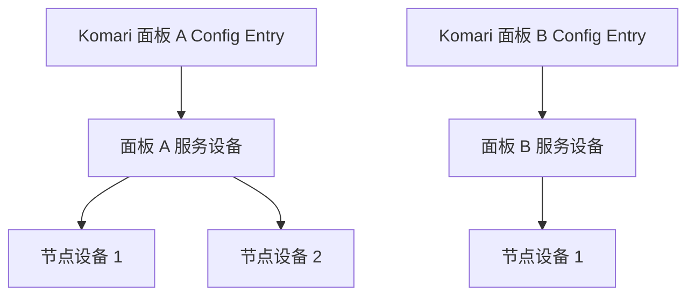

# Komari for Home Assistant


[](https://www.home-assistant.io/)
[](https://komari-monitor.github.io/komari-document/)


将一个或多个 [Komari](https://github.com/komari-monitor/komari) 服务器监控面板接入
[Home Assistant](https://www.home-assistant.io/) 的第三方自定义集成。

每次添加集成对应一个独立的 Komari 面板。集成会为面板创建一个服务设备，并将
面板中的每个节点创建为独立子设备，从而把服务器状态、资源使用、到期时间、流量
限额和 Ping 统计用于仪表盘、历史记录与自动化。

> [!WARNING]
> 当前版本为 `0.2.0-alpha.1`，适合测试和提前体验，尚未通过 HACS 发布，也不是
> Home Assistant 或 Komari 官方集成。升级前请备份 Home Assistant 配置。

## 目录

- [主要功能](#主要功能)
- [设备与实体](#设备与实体)
- [环境要求](#环境要求)
- [安装](#安装)
- [配置](#配置)
- [选项](#选项)
- [升级与卸载](#升级与卸载)
- [注意事项](#注意事项)
- [故障排查](#故障排查)
- [常见问题](#常见问题)
- [开发与测试](#开发与测试)
- [当前限制与路线图](#当前限制与路线图)
- [开发与验收指南](DEVELOPMENT.md)

## 主要功能

- 通过 Komari `/api/rpc2` 接口进行全异步 JSON-RPC 2.0 只读通信。
- 支持公开面板匿名访问，以及私有面板的 API Key 认证。
- 支持同时添加多个面板；每个面板拥有独立配置、轮询周期和故障状态。
- 自动发现面板节点，并在 Home Assistant 中建立面板与节点的父子设备关系。
- 提供节点在线状态、资源使用率、负载、温度、网络流量及连接数量。
- 根据 Komari 数据按需创建 GPU、温度、到期、续费和流量限额实体。
- 发现 Komari Ping 任务，由用户选择需要同步的任务和统计项。
- 支持配置重载、API Key 重新认证、URL/TLS 重新配置和旧配置迁移。
- 连续三次从权威清单中确认对象消失后，清理陈旧节点或 Ping 实体。
- 提供经过脱敏的 Diagnostics、低噪声错误日志和可自动清除的 Repairs。
- 提供简体中文和英文配置流程及实体名称。

## 设备与实体



不同面板即使报告相同节点 UUID，也会创建彼此隔离的设备和实体，不会错误合并。

### 面板设备

| 实体 | 类型 | 用途 |
| --- | --- | --- |
| RPC 连接 | Connectivity binary sensor | HA 是否能够连接面板 RPC2 |
| 任一节点故障 | Problem binary sensor | 是否存在明确离线的可见节点 |
| 节点总数 | Sensor | 当前可见节点数量 |
| 在线节点数 | Sensor | 当前明确在线的节点数量 |
| 离线节点数 | Sensor | 当前明确离线的节点数量 |
| Komari 版本 | Diagnostic sensor | 面板软件版本 |
| RPC 版本、构建哈希 | Diagnostic sensor | 协议及构建诊断信息 |

### 节点设备

| 分类 | 实体 |
| --- | --- |
| 连接状态 | 在线状态、最后采集时间 |
| 处理器 | CPU 使用率、GPU 使用率（存在有效 GPU 时） |
| 内存与存储 | 内存使用率/已用/总量、Swap 使用率/已用、磁盘使用率/已用/总量 |
| 系统负载 | 1、5、15 分钟负载，温度（存在有效温度时） |
| 网络 | 上下行速率、Agent 启动后累计上传/下载流量 |
| 连接与进程 | 进程数、TCP 连接数、UDP 连接数 |
| 到期与续费 | 到期时间、剩余时间、是否到期、自动续费、计费周期 |
| 流量限额 | 限额、限额口径、按口径计算的已用流量、使用率 |
| Ping | 最新延迟、丢包率及可选的 min/max/avg/P50/P99/stddev |

部分诊断实体默认禁用。GPU、温度、到期和流量实体只有在服务端提供有效数据时才会
创建，这种按能力创建的行为是正常设计，并不表示集成加载失败。

## 环境要求

| 项目 | 要求 |
| --- | --- |
| Home Assistant | `2026.8.2` 或更高版本；这是当前开发与测试基线 |
| Komari | `1.0.7` 或更高版本；RPC2 官方最低版本，推荐使用当前稳定版 |
| 网络 | Home Assistant 必须能够访问面板根地址及其 `/api/rpc2` 路径 |
| 认证 | 公开面板可匿名；私有面板需要有效 API Key |
| 安装权限 | 能够向 Home Assistant 配置目录写入 `custom_components` |
| Python | 普通用户无需单独安装；开发环境使用 Python `3.14.x` |

功能不是单纯按 Komari 版本号启用。集成会调用 `rpc.methods` 探测面板实际能力；旧
版本缺少可选 Ping 方法时，核心节点监控仍可继续工作。

当前主要在 Home Assistant Core 开发环境中验证。Home Assistant OS、Supervised 和
Container 只要允许安装自定义集成，理论上使用相同目录结构；正式发布前仍建议先在
测试实例中验证。

## 安装

### 手动安装

1. 从 GitHub Releases 下载目标版本的源码压缩包并解压。
2. 将仓库中的 `custom_components/komari` 整个目录复制到 Home Assistant 配置目录：

   ```text
   <config>/custom_components/komari
   ```

3. 确认最终路径中直接包含 `manifest.json`，不要多嵌套一层仓库目录：

   ```text
   <config>/custom_components/komari/manifest.json
   ```

4. 重启 Home Assistant。
5. 打开“设置 → 设备与服务 → 添加集成”，搜索 **Komari**。

不同安装方式的 `<config>` 位置可能不同。Home Assistant OS 通常为 `/config`；
Container 用户应使用映射到容器 `/config` 的宿主机目录。

### HACS

当前版本尚未包含 `hacs.json`，不能作为 HACS 仓库安装。请勿把仓库手动加入 HACS
后将安装成功视为受支持流程；HACS 发布将在后续版本单独说明。

## 配置

添加集成时需要填写：

| 字段 | 必填 | 说明 |
| --- | --- | --- |
| 面板 URL | 是 | Komari 面板根地址，例如 `https://monitor.example.com` |
| API Key | 否 | 公开面板可留空；私有面板需要填写 |
| 验证 TLS 证书 | 是 | 默认开启，生产环境建议始终保持开启 |

URL 末尾误填 `/api/rpc2` 时会自动规范化为面板根地址。URL 不应包含用户名、密码、
query 或 fragment。同一规范化 URL 只能添加一次。

若需要同时监控多个面板，请重复“添加集成”。每个面板都是独立 Config Entry，可使
用不同 API Key、TLS 设置、轮询周期和 Ping 任务。

私有面板建议创建仅供 Home Assistant 使用的专用 API Key，不要复用账号密码，也
不要把 Key 写入 YAML、自动化、截图或公开 Issue。

## 选项

在“设置 → 设备与服务 → Komari → 配置”中，可以为每个面板单独调整：

| 选项 | 默认值 | 可选范围或限制 |
| --- | ---: | --- |
| 核心状态轮询周期 | 30 秒 | 15～300 秒 |
| Ping 统计轮询周期 | 300 秒 | 60～1800 秒 |
| 到期/续费实体 | 开启 | 可关闭并清理对应实体 |
| 流量限额实体 | 开启 | 可关闭并清理对应实体 |
| Ping 任务 | 不选择 | 每个面板最多选择 8 个 |
| Ping 统计项 | `latest`、`loss` | 可增加 min/max/avg/P50/P99/stddev |

>  **注意**: 频率建议按照自己需求调整，过高频率的持续获取可能会消耗过多流量。

### 数据刷新频率

各数据分支在集成首次加载时会立即获取，后续按下频率进行刷新：

| 数据项目 | 默认频率 | 是否可配置 | 说明 |
| --- | ---: | --- | --- |
| 节点在线状态、CPU、内存、磁盘、负载、网络和连接数 | 30 秒 | 是，15～300 秒 | 使用当前面板的“核心状态轮询周期” |
| 到期时间、自动续费、计费周期、流量限额和限额口径 | 10 分钟 | 否 | 这些项目来自节点清单；在 Komari 中修改后，HA 通常会在下一次节点清单刷新时取得新值 |
| 剩余时间和是否到期 | 30 秒 | 随核心状态周期 | 使用已取得的到期时间和当前 UTC 时间重新计算，因此到期状态最多延迟一个成功的核心轮询周期 |
| 按限额口径计算的已用流量和使用率 | 30 秒 | 随核心状态周期 | 使用最新 Agent 累计上传/下载计数计算；Agent 重启可能使计数归零 |
| 节点清单和新节点发现 | 10 分钟 | 否 | 清单暂时刷新失败时保留上一次成功结果，不立即删除节点 |
| Ping 任务列表 | 10 分钟 | 否 | 新任务先出现在选项中，不会自动启用 |
| 已选择的 Ping 统计 | 300 秒 | 是，60～1800 秒 | 使用当前面板的“Ping 统计轮询周期” |
| 面板版本和 RPC 能力 | 6 小时 | 否 | 用于低频能力探测和可选功能降级 |

上述周期从每个 Config Entry 各自计算，多个面板互不影响。若核心状态刷新失败，该面板
的运行时实体会暂时不可用；节点清单或 Ping 分支单独失败时，会保留旧结果到相应的
过期或清理条件满足，不影响其他面板和可继续刷新的核心实体。

Ping 实体数量按“可见节点 × 已选任务 × 已选统计项”增长。每个面板最多创建 256 个
Ping 实体；配置时超过上限会阻止保存，运行中因节点增长超过上限会创建 Repair。

如果需要立即同步数据，可以主动重新加载中枢。这么做会将立刻更新全部数据

### 重新认证与重新配置

- API Key 失效时，Home Assistant 会发起 Reauth；新 Key 成功后沿用原有设备和实体
  标识。
- “重新配置”可修改面板 URL 和 TLS 验证设置，但不会显示或修改 API Key。
- URL 实际变化需要二次确认。若是完全不同的面板，更推荐新增 Config Entry，避免
  把旧设备身份复用于另一套数据。

## 升级与卸载

### 手动升级

1. 备份 Home Assistant 配置。
2. 下载目标版本，并用新的 `custom_components/komari` 覆盖旧目录内容。
3. 重启 Home Assistant。
4. 在集成页面确认版本、设备和实体正常；不要先删除 Config Entry，否则可能失去
   原有实体历史关联。

### 卸载

1. 在“设置 → 设备与服务”中删除所有 Komari Config Entry。
2. 删除 `<config>/custom_components/komari` 目录。
3. 重启 Home Assistant。

## 注意事项

### 流量并非权威账期用量

累计上传、累计下载和“按限额口径计算的已用流量”来自 Komari Agent 计数器。
Agent 重启、重装或计数器复位后，数值可能从较小值重新开始。集成会标记
`calculation_source=agent_counters` 和 `reset_sensitive=true`，不会在 Home
Assistant 本地猜测或拼接账期账单。

流量限额口径支持 `sum`、`max`、`min`、`up` 和 `down`。使用率允许超过 100%，以便
自动化识别已经超额的节点。

### 可用性语义

- 面板不可达：面板 RPC 连接显示 `off`，该面板下的数据实体不可用。
- 节点明确离线：节点连接显示 `off`，动态数值实体不可用，最后采集时间保留。
- 节点状态缺失：连接状态和动态数值实体显示 unavailable，而不是误报离线。
- Ping 分支失败：只影响 Ping 实体，不影响 CPU、内存等核心监控。
- 节点或任务暂时未出现在清单中：连续三次权威清单确认缺失后才会清理。

### 安全与隐私

- 生产环境优先使用 HTTPS，并保持 TLS 证书验证开启。
- API Key 保存在 Home Assistant Config Entry 中，不会作为实体属性输出。
- 集成不会把完整 URL、IP、UUID、节点名称、任务目标或原始响应写入 Diagnostics。
- Diagnostics 已做结构化脱敏，但公开上传前仍应由用户自行检查内容。
- 集成只调用只读 RPC 方法，不会创建、修改或删除 Komari 面板中的节点和任务。

### 设备名称

 - 在面板新增服务器后，集成会自动检测并添加服务器到中枢中
 - 面板修改设备名后，集成会在同步设备清单时进行同步
 - 如果立即同步面板修改的设备名，需要主动重新加载集成
 - 重新加载集成不会修改在HA上修改的设备名

## 故障排查

### 1. 下载 Diagnostics

打开“设置 → 设备与服务 → Komari”，在目标面板右侧菜单中选择“下载诊断信息”。
Diagnostics 可用于判断能力、刷新分支和错误类别，不包含真实监控指标值。

### 2. 启用调试日志

临时在 `configuration.yaml` 中加入：

```yaml
logger:
  default: info
  logs:
    custom_components.komari: debug
```

重启 Home Assistant 或重新加载日志配置后复现问题。收集完成后请移除该配置，避免
长期产生大量日志。

### 3. 提交问题时提供

- 集成版本、Home Assistant 版本和 Komari 版本。
- 问题发生在配置、核心状态、Ping、到期流量还是设备清理阶段。
- 可复现步骤和预期行为。
- 已人工检查过的 Diagnostics 与必要日志。

请勿提交 API Key、Cookie、Authorization Header、节点 Token、或未经脱敏的原始 RPC 响应。

欢迎提交issues！

## 常见问题

### Q：安装后搜索不到 Komari？

确认目录为 `<config>/custom_components/komari/manifest.json`，然后完整重启 Home
Assistant。若目录多嵌套了一层，Home Assistant 不会发现该集成。

### Q：配置时提示无法连接？

确认填写的是面板根地址、Home Assistant 能访问该地址，并且 Komari 版本支持
`/api/rpc2`。使用 HTTPS 时还应检查证书链和系统时间；不要为了绕过证书错误长期
关闭 TLS 验证。

### Q：公开面板必须填写 API Key 吗？

不一定。Komari RPC2 允许匿名调用，但面板可以限制公开数据和方法。私有面板或受限
方法需要 API Key。

### Q：可以同时添加多个 Komari 面板吗？

可以。每次添加都会创建独立 Config Entry、面板设备和节点设备，配置与故障不会
互相影响。

### Q：为什么没有 GPU 或温度实体？

只有存在有效 GPU 名称、观察到有效 GPU 使用率，或温度位于合理范围时才创建对应
实体。`0`、空值、`n/a` 和异常温度不会被当作硬件能力。

### Q：为什么没有到期或流量限额实体？

确认相关选项已开启，并检查节点是否配置了有效到期时间或大于零的流量限额。未
配置相应元数据的节点不会创建这些实体。

### Q：为什么看不到 Ping 实体？

需要面板公开对应 Ping RPC 能力，并在集成选项中显式选择任务和统计项。新增任务
只会出现在选项中，不会自动创建实体。

### Q：为什么部分 Ping 统计显示 unavailable？

服务端可能没有返回该节点、任务或字段的数据；数据过期、节点离线和 Ping 分支请求
失败也会令对应实体不可用。单个统计字段缺失不会影响其他 Ping 或核心实体。

### Q：为什么流量值与 Komari 账单周期不一致？

本集成使用 Agent 累计计数器，不是 Komari 的权威账期账单。Agent 重启可能导致
计数器复位，因此更适合趋势观察和基于当前计数器的提醒。

### Q：API Key 被撤销后怎么办？

Home Assistant 会为原 Config Entry 发起重新认证。在 Reauth 表单中填写替换 Key
即可，不需要删除并重新添加集成。

### Q：可以通过 HACS 安装吗？

当前不可以。项目尚未添加 HACS 发布元数据，请使用手动安装方式。

### Q：是否支持 Komari 动态/自定义指标？

当前版本尚未实现动态指标。CPU、内存、磁盘、网络和 Ping 等已内置指标不受
影响，动态指标计划在后续版本加入。

## 当前限制与路线图

当前版本不包含：

- 动态/自定义指标发现与映射（F16）。
- HACS 元数据、GitHub Actions 和正式发布自动化。
- WebSocket、JSON-RPC batch 和完整历史数据导入。
- Home Assistant 本地账期流量重建。

后续计划依次完成动态指标、HACS 发布支持、完整兼容性矩阵和稳定版本发布。

## 设计文档

- [开发与验收指南](DEVELOPMENT.md)
- [总体设计与调研](KOMARI_HOME_ASSISTANT_INTEGRATION_PLAN.md)
- [逐功能代码实现方案](KOMARI_HOME_ASSISTANT_IMPLEMENTATION_PLAN.md)
- [Komari 官方文档](https://komari-monitor.github.io/komari-document/)
- [Komari RPC2 文档](https://komari-monitor.github.io/komari-document/dev/rpc)
- [Home Assistant 自定义集成开发文档](https://developers.home-assistant.io/)


## 免责声明

本项目与 Home Assistant、Nabu Casa 和 Komari 官方等无隶属关系。使用本集成产生的
配置、监控和自动化风险由使用者自行承担。
